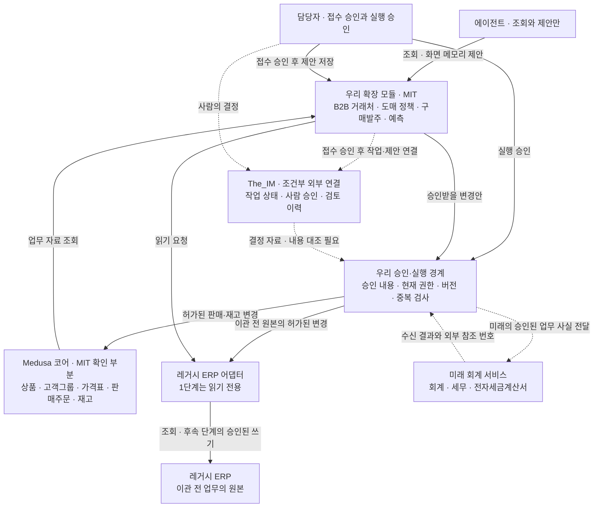

# 전체 구조와 담당 역할

[추측] 판매·재고의 공통 기능은 Medusa가 맡는다. 회사 관리, 구매발주, 승인 검사, 예측은 우리 확장 모듈이 맡는다. 자료를 최종적으로 기록하는 시스템은 업무별로 하나만 둔다. 이를 원본 시스템이라고 부른다.

## 제안 구조

[추측] 다음 도식은 목표 구조이다. MIT 구성 검증과 The_IM 외부 연동 범위 결정 전에는 실제 설치 구조로 확정하지 않는다. 점선은 미래 또는 조건부 연결이다.

## 역할과 경계

| 구성요소 | 역할 | 제외하거나 추가할 부분 |
| --- | --- | --- |
| Medusa 코어 | [확인한 사실](https://github.com/medusajs/medusa/blob/develop/www/apps/resources/app/recipes/b2b/page.mdx) 고객그룹·가격표를 B2B에 재사용할 수 있다. | [추측] Enterprise 부분과 회계 업무는 채택하지 않는다. |
| 우리 확장 모듈 | [확인한 사실](https://github.com/medusajs/medusa/blob/develop/www/apps/book/app/learn/customization/custom-features/module/page.mdx) 별도 모듈에 데이터와 업무 처리를 추가하는 구조를 제공한다. | [추측] 회사·공급사·승인 계약·예측을 독립적으로 만든다. |
| 모듈 연결 | [확인한 사실](https://github.com/medusajs/medusa/blob/develop/www/apps/book/app/learn/fundamentals/module-links/page.mdx) 서로 다른 모듈의 자료를 연결할 수 있다. | [추측] Medusa 내부 표를 직접 수정하지 않고 연결 ID를 사용한다. |
| 승인·실행 경계 | [추측] 승인한 변경안과 현재 자료가 일치할 때만 확정 기록·실행한다. | [추측] 사람 요청과 에이전트 요청에 같은 검사를 적용한다. |
| The_IM | [추측] 기존 상태 이름과 전이 규칙을 검토·승인 절차에 재사용한다. | [추측] Apache-2.0 코드는 가져오지 않는다. 외부 연결은 허용 범위 결정 후에만 검토한다. |
| 레거시 ERP 어댑터 | [확인한 사실](https://github.com/medusajs/medusa/blob/develop/www/apps/book/app/learn/customization/integrate-systems/service/page.mdx) 외부 시스템을 별도 모듈 서비스로 연결하는 가이드가 있다. | [추측] 실제 레거시 규격 변환·코드 대응·재시도는 우리 책임이다. |
| 미래 회계 서비스 | [추측] 확정 업무 자료를 받아 회계 업무를 처리하는 별도 시스템이다. | [추측] 현재는 경계만 정한다. 실제 전송이나 회계 처리는 구현하지 않는다. |

## 업무별 원본

| 자료 | 이관 전 원본 | 해당 업무 이관 후 원본 |
| --- | --- | --- |
| 거래처·상품 코드 | [추측] 레거시 ERP | [추측] 승인된 코드 대응표와 우리 거래처 모듈·Medusa 상품 |
| 계약 단가 | [추측] 레거시 ERP | [추측] 우리 도매 정책과 Medusa 가격표 |
| 구매발주·입고 예정 | [추측] 레거시 ERP | [추측] 우리 구매발주 모듈 |
| 현재 재고·예약 | [추측] 레거시 ERP | [추측] Medusa 재고. 로트가 필요하면 우리 로트 모듈과 수량을 대조한다. |
| 판매주문·고객 반품 | [추측] 레거시 ERP | [추측] Medusa 주문·반품 |
| 제안·승인·실행 이력 | [추측] 사람이 접수를 승인한 우리 제안 저장소 | [추측] 우리 저장소. The_IM에는 허용된 연결 자료만 둔다. |

[추측] 이관한 업무에는 두 시스템이 동시에 쓰지 못하게 한다. 전환 시각과 원본 시스템을 기록한다. 예전 ERP 화면은 필요하면 조회용으로 남긴다. 재고 예약 수량은 예약 기능으로 바꾸고 직접 덮어쓰지 않는다.

## 미래 회계 서비스와의 경계

[추측] 전달 후보는 확정 판매, 출고, 입고, 고객 반품의 업무 사실이다. 자료에는 업무 ID, 버전, 발생 시각, 거래처 외부 ID, 상품·수량·통화·확정 금액, 원본 참조를 둔다. 같은 업무 버전을 구분하는 전송 키도 둔다. 금액의 정밀도와 부가세 포함 여부는 계약에서 명시하되 세액을 새로 산출하지 않는다.

[추측] 회계 서비스는 수신 성공·실패, 외부 참조 번호, 오류 사유만 돌려준다. 회계 서비스가 판매주문이나 실물 재고를 직접 고치지 못하게 한다. 취소·정정은 원 업무 ID를 참조하는 새 사실로 보낸다. 분개, 세무 신고, 전자세금계산서 발행·취소, 결제 실행은 이번 설계의 실행 범위에서 제외한다.

## 장애 처리

[확인한 사실](https://docs.medusajs.com/learn/fundamentals/workflows/long-running-workflow) Medusa workflow는 외부 작업을 기다린 뒤 실행을 이어갈 수 있다. 로컬 근거는 `www/apps/book/app/learn/fundamentals/workflows/long-running-workflow/page.mdx`이다.

[추측] 이 기능만으로 사람 승인과 외부 시스템의 중복 실행 방지가 완성됐다고 보지 않는다. The_IM 연결이 끊기면 ERP 쓰기를 멈춘다. 레거시 응답이 불명확하면 원본에서 결과를 조회한다. 실패를 성공으로 바꾸거나 바로 다시 쓰지 않는다.
